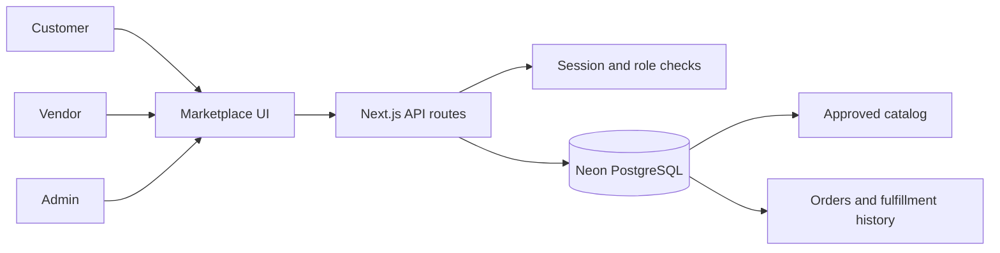

# Sportivo Marketplace Workflow

This document describes the workflows currently implemented in this repository. It is an implementation guide, not a list of planned features.

## Application shape

- **UI:** Next.js App Router pages and React client components in `app/` and `components/`.
- **API:** Route handlers under `app/api/` perform input validation, authentication, authorization, and database work.
- **Database:** Neon PostgreSQL accessed through parameterized queries in `lib/db.ts`.
- **Authentication:** bcrypt password hashes and a signed, HTTP-only `sportivo_session` cookie managed in `lib/auth.ts`. The session lasts seven days; the server reloads the active user and role for protected requests.
- **Database setup:** `db/schema.sql` is the fresh-install schema. Existing installations use the SQL files in `db/migrations/`.

The main UI and API flow is:

## Roles and access

| Account | Role value | How access is obtained | Main permissions |
| --- | --- | --- | --- |
| Customer | `user` | Public signup | Browse, wishlist, addresses, cart, checkout, own orders, cancellation and eligible return pickup |
| Vendor | `vendor` | Customer submits an application; an admin verifies it | Manage own products, fulfillment, tracking, return pickups, and category suggestions while verified and active |
| Administrator | `admin` | Configured bootstrap email or an existing admin account | Review vendor applications, products, and categories; suspend/reactivate verified vendors; remove vendor listings |

Public signup does not accept a role. The server grants vendor role when an admin verifies the user's application. Admin access is checked on the server by `requireAdmin`; the browser's role display is only for navigation. `BOOTSTRAP_ADMIN_EMAIL` can promote the matching account during signup or login, so keep that setting private and use an email controlled by the administrator.

## Customer workflow

1. The customer signs up or signs in through `/api/auth/signup` or `/api/auth/login`. Passwords are hashed with bcrypt. Logout clears the session cookie.
2. The catalogue calls `GET /api/products`. It returns approved products from active, verified vendors (and any platform-owned products), in approved categories. Search, category, sort, and paged loading are passed as query parameters.
3. Signed-in customers can save approved products to their wishlist, save delivery addresses, and add available products to their database-backed cart. Cart writes validate product availability and stock.
4. Checkout sends the delivery details and an idempotency key to `POST /api/orders`. The PostgreSQL function recalculates prices and shipping, locks cart/product rows, verifies and decrements stock, snapshots item names/prices/commission, creates vendor fulfillment records, clears the cart, and records order history in one transaction.
5. Customers see only their own orders through `GET /api/orders`. An eligible order can be cancelled before shipment (statuses `placed`, `confirmed`, or `packed`); cancellation restores inventory. After an order is cancelled or delivered, the customer can request return pickup. The vendor then progresses the pickup through its steps.

## Vendor workflow

1. A signed-in customer applies through the Seller Studio by sending a store name and description to `POST /api/vendor`. The initial application is pending. An admin can approve it or reject it with a review reason; a rejected applicant can edit and resubmit.
2. Once verified and active, the vendor can suggest a category through `POST /api/categories`. New suggestions are pending and are not usable for listings or visible in the public catalogue until approved by an admin. Existing product labels imported by the migration also begin pending review.
3. The vendor submits a product through `POST /api/vendor`. The chosen category must already be approved. New products are pending admin review. Editing a product is restricted to its owner and sends the listing back to pending review. Deletion is likewise limited to the vendor's own product.
4. The Seller Studio displays the vendor's products and calculated counts for published/pending products, low stock (fewer than 10), out-of-stock, ordered, in-progress, delivered, and cancelled records. The order list is scoped to the vendor's own fulfillment allocations and supports paged loading.
5. Fulfillment advances in order: `pending → packed → shipped → out_for_delivery → delivered`. Vendors can save a carrier, tracking number, and HTTP(S) tracking link. Each status change is recorded in fulfillment history. The platform order becomes delivered after all vendor allocations are delivered.
6. For cancelled or delivered orders, the customer can request a pickup. The vendor advances that pickup `requested → scheduled → picked_up → received`; the history is retained.

Vendor product and order operations check the signed-in user's vendor record on the server. The vendor APIs scope product edits/deletes and fulfillment updates to that vendor.

## Administrator workflow

1. The Admin Studio loads data from `GET /api/admin`, which requires an authenticated `admin` role.
2. The admin reviews vendor details and can verify or reject an application. Verification changes the associated account role to `vendor`; rejection can include a reason. Verified vendors can be suspended or reactivated.
3. The admin reviews vendor product listings and can approve/reject them, enter a rejection reason, or delete a vendor listing. A product cannot be approved while its category is unapproved.
4. The admin reviews category suggestions and can approve/reject them with a reason. Only approved categories are returned by the public categories API.
5. The admin UI displays the configured commission rate returned by the API. Administrative vendor, product, and category review actions are written to `audit_logs`.

## Commission and order values

The initial marketplace setting is a **30% commission** (`0.30`). At checkout, the database snapshots the applicable commission rate and commission amount onto each vendor order item. Vendor sales summaries use delivered allocations to show gross sales, recorded commission, and net earnings (gross minus commission). These values describe order accounting; they do not mean money has been collected or paid out.

In the current Admin API, `GET /api/admin` exposes the configured rate, but `POST /api/admin` does not implement a commission-rate update action or a commission ledger/report. Change the setting through a reviewed database migration or implement an authorized admin setting action before relying on an in-app rate editor. Payouts and settlement tracking are not implemented.

## API map

| Endpoint | Current purpose | Access |
| --- | --- | --- |
| `/api/auth/signup`, `/api/auth/login`, `/api/auth/logout` | Account creation, session creation, and session clearing | Public for signup/login; current session for logout |
| `/api/me` | Current authenticated account | Signed in |
| `/api/products` | Approved, searchable, paginated product catalogue | Public |
| `/api/categories` | Approved categories; `?mine=1` returns the signed-in vendor's suggestions | Public list; signed in for own list; verified vendor to suggest via POST |
| `/api/cart` | Read/update current user's cart | Signed in |
| `/api/addresses` | List, save, and delete own delivery addresses | Signed in |
| `/api/wishlist` | List and update own saved products | Signed in |
| `/api/orders` | Place orders, list own history, cancel eligible order, request return pickup | Signed in |
| `/api/vendor` | Vendor application, own products, own order allocations, listing edits, fulfillment/tracking, pickup progress | Signed in; verified/active vendor for selling operations |
| `/api/admin` | Read platform vendor/product/category data and perform moderation actions | Admin only |

## Important states

| Record | States in the current workflow |
| --- | --- |
| Vendor application | `pending`, `verified`, `rejected`; verified vendors also have an active/suspended flag |
| Vendor product | `pending`, `approved`, `rejected` |
| Vendor category | `pending`, `approved`, `rejected` |
| Vendor fulfillment | `pending`, `packed`, `shipped`, `out_for_delivery`, `delivered`, `cancelled` |
| Return pickup | `none`, `requested`, `scheduled`, `picked_up`, `received` |
| Customer order | Starts `placed`; cancellation is allowed only while `placed`, `confirmed`, or `packed`; becomes delivered when all vendor fulfillments are delivered |

## Setup and local run

1. Configure `.env.local` in the app directory with `DATABASE_URL` and an `AUTH_SECRET` of at least 32 characters. Set `BOOTSTRAP_ADMIN_EMAIL` if bootstrapping the first administrator.
2. For a new database, apply `db/schema.sql`. For an existing database, apply migrations in order: `db/migrations/001_secure_roles_and_checkout.sql`, then `db/migrations/002_vendor_categories_and_returns.sql` (skip any migration already applied). Keep database migrations with the code changes.
3. Run `npm install`, then `npm run dev` from the app directory.
4. The project scripts also provide `npm run lint` (TypeScript check) and `npm run build`.

## Current implementation boundaries

- Checkout is **demo-only**. Orders are created with the demo payment status; no payment gateway is charged or verified.
- Commission is recorded as an order snapshot. There is no payout, settlement, refund, or actual commission collection workflow.
- Vendor application currently collects store name and description. It does not collect business documents or implement verification services.
- Product imagery uses the current emoji field; cloud image upload, product variants, reviews, support tickets, email verification, password reset, and notifications are not implemented.
- Do not interpret an order status or commission amount as evidence of payment or payout.

## Source files to follow

- UI composition and API calls: `components/Marketplace.tsx`
- Customer-facing account, catalogue, cart, and order views: `components/ClientDashboard.tsx` and `components/Marketplace.tsx`
- Vendor workflow: `components/VendorPanel.tsx`, `app/api/vendor/route.ts`, `app/api/categories/route.ts`
- Admin review workflow: `components/AdminDashboard.tsx`, `app/api/admin/route.ts`
- Authentication and authorization: `lib/auth.ts`, `app/api/auth/`, `app/api/me/route.ts`
- Checkout and schema: `app/api/orders/route.ts`, `db/schema.sql`, `db/migrations/`
